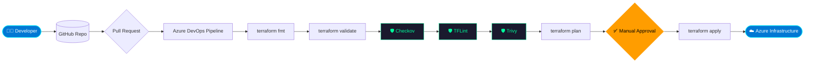
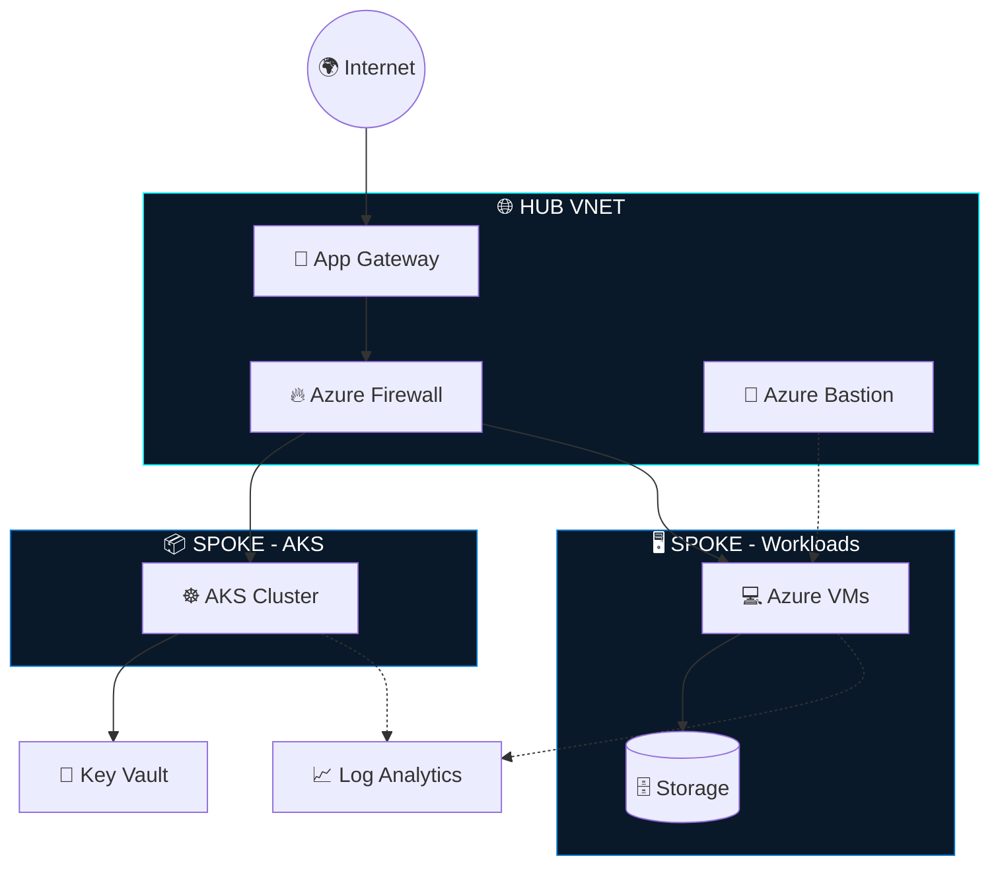

<!-- ═══════════════ HEADER ═══════════════ -->
<p align="center">
  
</p>

<p align="center">
  
</p>

<p align="center">
  <a href="https://github.com/asmitmaurya585"></a>
  <a href="https://github.com/asmitmaurya585?tab=followers"></a>
  <a href="https://github.com/asmitmaurya585"></a>
  
</p>


<!-- ═══════════════ TERMINAL ABOUT ═══════════════ -->
## 🖥️ `$ whoami`

```bash
┌──(asmit㉿azure-cloud)-[~/profile]
└─$ cat about.yaml

  name          : Asmit Kumar Maurya
  role          : Azure DevOps Engineer
  experience    : 2.7+ years
  cloud         : Microsoft Azure ☁️
  iac           : Terraform
  containers    : Docker  |  Kubernetes (AKS)
  ci_cd         : Azure DevOps  |  GitHub Actions
  scripting     : Bash  |  Azure CLI  |  PowerShell  |  Python
  devsecops     : SonarQube  |  Checkov  |  Trivy  |  TFLint
  mission       : "Automate Everything. Build Secure Cloud Platforms."
  status        : 🟢 ONLINE — building the future, one pipeline at a time

┌──(asmit㉿azure-cloud)-[~/profile]
└─$ _
```

<!-- ═══════════════ TECH STACK ═══════════════ -->
## ⚡ Tech Arsenal

<p align="center">
  
</p>

<p align="center">
  
  
  
  
  
  
  
  
</p>

<!-- ═══════════════ SKILL BARS ═══════════════ -->
## 📊 Power Levels

| Skill | Power | Level |
|:------|:------|:------|
| ☁️ **Azure** |  | `ELITE` |
| 🏗️ **Terraform** |  | `ELITE` |
| 🔄 **Azure DevOps** |  | `ELITE` |
| 🐧 **Linux** |  | `ADVANCED` |
| 📜 **Bash / Scripting** |  | `ADVANCED` |
| ☸️ **Kubernetes (AKS)** |  | `LEVELING UP` |
| 🐳 **Docker** |  | `LEVELING UP` |
| 🐍 **Python** |  | `LEVELING UP` |

<!-- ═══════════════ CI/CD FLOW ═══════════════ -->
## 🔄 CI/CD Pipeline — Secure by Design



<!-- ═══════════════ ARCHITECTURE ═══════════════ -->
## 🏛️ Azure Hub-Spoke Architecture



<!-- ═══════════════ EXPERTISE ═══════════════ -->
## 🧠 Knowledge Base

<details>
<summary><b>☁️ Azure Expertise</b> &nbsp;<i>(click to expand)</i></summary>
<br>

`Virtual Machines` `Virtual Network` `NSG` `Application Gateway` `Load Balancer` `Azure Firewall` `Azure Bastion` `Key Vault` `Storage` `Azure Monitor` `Log Analytics` `Azure Policy` `RBAC` `Azure DNS` `Azure Backup` `Site Recovery` `Azure CLI`

</details>

<details>
<summary><b>🚀 DevOps & DevSecOps</b> &nbsp;<i>(click to expand)</i></summary>
<br>

`Azure DevOps Pipelines` `GitHub Actions` `Terraform` `Docker` `Kubernetes (AKS)` `SonarQube` `Checkov` `Trivy` `TFLint` `Git` `Bash` `Python`

</details>

<details>
<summary><b>☸️ Kubernetes</b> &nbsp;<i>(click to expand)</i></summary>
<br>

`AKS Deployment` `Deployments` `Services` `Ingress` `ConfigMaps` `Secrets` `Helm Charts` `HPA` `Rolling Updates` `Namespaces`

</details>

<details>
<summary><b>📦 Terraform Modules</b> &nbsp;<i>(click to expand)</i></summary>
<br>

`Azure VM` `VNet` `NSG` `Storage Account` `Key Vault` `Application Gateway` `Load Balancer` `Azure Firewall` `Log Analytics` `AKS` `Bastion Host`

</details>

<!-- ═══════════════ PROJECTS ═══════════════ -->
## 🚀 Featured Missions

<table>
<tr>
<td width="50%">

### 🏢 Azure Landing Zone
Enterprise-grade Landing Zone built with Terraform.<br>
`Terraform` `Azure Policy` `RBAC`

</td>
<td width="50%">

### 🌐 Hub-Spoke Network
Scalable Azure networking topology as code.<br>
`VNet` `Peering` `NSG` `Firewall`

</td>
</tr>
<tr>
<td>

### ☸️ AKS Deployment
Production-ready Kubernetes cluster on Azure.<br>
`AKS` `Helm` `Ingress` `HPA`

</td>
<td>

### 🔥 Azure Firewall
Secure network perimeter and traffic control.<br>
`Firewall` `UDR` `DNAT`

</td>
</tr>
<tr>
<td>

### 🖥️ Azure VM Automation
Complete VM deployment, fully automated.<br>
`Terraform` `Bash` `Azure CLI`

</td>
<td>

### 🔄 Azure DevOps YAML Pipelines
Multi-stage CI/CD with security gates.<br>
`YAML` `Checkov` `Trivy` `SonarQube`

</td>
</tr>
<tr>
<td colspan="2" align="center">

### 📦 Reusable Terraform Modules
A library of plug-and-play infrastructure modules.<br>
`Modules` `DRY` `Versioned`

</td>
</tr>
</table>

<!-- ═══════════════ CURRENT FOCUS ═══════════════ -->
## 🎯 Current Quest Log

```diff
+ [ACTIVE]    Azure Landing Zone
+ [ACTIVE]    Terraform Modules
+ [ACTIVE]    Azure DevOps Pipelines
+ [ACTIVE]    AKS Production
! [LEARNING]  DevSecOps
! [LEARNING]  GitOps (ArgoCD)
! [LEARNING]  Monitoring (Prometheus + Grafana + Azure Monitor)
- [LOCKED]    Platform Engineering -> coming soon...
```

## 🏅 Achievements

<p>
  
  
</p>


<!-- ═══════════════ STATS ═══════════════ -->
## 📡 Live Telemetry

<p align="center">
  
  
</p>

<p align="center">
  
</p>

<p align="center">
  
</p>

<p align="center">
  
</p>

## 🐍 Contribution Snake

<p align="center">
  <picture>
    <source media="(prefers-color-scheme: dark)" srcset="https://raw.githubusercontent.com/asmitmaurya585/asmitmaurya585/output/github-snake-dark.svg"/>
    <source media="(prefers-color-scheme: light)" srcset="https://raw.githubusercontent.com/asmitmaurya585/asmitmaurya585/output/github-snake.svg"/>
    
  </picture>
</p>

<!-- ═══════════════ LEARNING ═══════════════ -->
## 🌱 Currently Downloading Knowledge...

<p align="center">
  
  
  
  
  
</p>

## 💬 Dev Quote

<p align="center">
  
</p>

<!-- ═══════════════ CONNECT ═══════════════ -->
## 📫 Establish Connection

<p align="center">
  <a href="mailto:asmitmaurya585@gmail.com"></a>
  <a href="https://linkedin.com/in/asmit-maurya"></a>
  <a href="https://github.com/asmitmaurya585"></a>
</p>

## 💡 Core Directives

```text
01 ▸ 🚀 Automate Everything
02 ▸ ☁️  Build Secure Cloud Platforms
03 ▸ 📦 Write Reusable Terraform Modules
04 ▸ 🔄 Deliver Reliable CI/CD Pipelines
05 ▸ 📚 Never Stop Learning
```

<p align="center">
  
</p>


